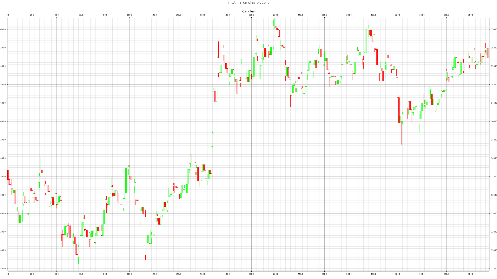

# Trade Aggregation
A high performance, modular and flexible trade aggregation crate, producing Candle data, 
suitable for low-latency applications and incremental updates.
It allows the user to choose the rule dictating how a new candle is created 
through the [AggregationRule](src/aggregation_rules/aggregation_rule_trait.rs) trait, 
e.g: Time, Volume based or some other information driven rule.
It also allows the user to choose which type of candle will be created from the aggregation process
through the [ModularCandle](src/modular_candle_trait.rs) trait. Combined with the [Candle](trade_aggregation_derive/src/lib.rs) macro, 
it enables the user to flexibly create any type of Candle as long as each component implements 
the [CandleComponent](src/candle_components/candle_component_trait.rs) trait.
The aggregation process is also generic over the type of input trade data
as long as it implements the [TakerTrade](src/types.rs) trait, 
allowing for greater flexibility for downstream projects.

See [MathisWellmann/go_trade_aggregation](https://github.com/MathisWellmann/go_trade_aggregation) for a go implementation with less features and performance.

Here is a sample trade series of `Bitmex_XBTUSD` aggregated into 15 minute candles:


## Features:
### `AggregationRule`:
The pre-existing rules in this crate include:
'AggregationRule'   | Description
--------------------|-------------
`TimeRule`          | Create candles every n seconds
`AlignedTimeRule`   | Same as TimeRule but candles are aligned to the start of a period
`VolumeRule`        | Create candles every n units traded
`TickRule`          | Create candles every n ticks
`RelativePriceRule` | Create candles with every n basis points price movement (Renko)
`RangeRule`         | Create range bars: close a candle when its (high - low) / open reaches n basis points
`DirectionalChangeRule` | Close a candle at every directional change: a reversal of n basis points from the last extreme ("intrinsic time")
`CusumRule`         | Close a candle when a symmetric CUSUM filter on log returns reaches n basis points (a drift in one direction)
`VolatilityRule`    | Create volatility bars: close a candle when the sum of absolute log returns reaches n basis points

Rules can be combined:
'Combinator'          | Description
----------------------|-------------
`AnyRule<A, B>`       | Close the candle when either rule triggers, e.g. dollar volume or volatility, whichever comes first ("hybrid bars")
`AllRule<A, B>`       | Close the candle once both rules have triggered since it opened
`MinDuration<R>`      | Keep every candle open for at least a given period, so bursts do not create a flood of tiny candles
`MaxDuration<R>`      | Close a candle at the first trade more than a given period after it opened, so quiet markets still produce candles

`Adaptive<R>` recalibrates the threshold of a rule (any rule that implements `ThresholdRule`) after each of its candles,
so that candles last about a target duration whatever the activity of the market.
A fixed threshold drifts with the regime: a candle of 20000 trades can last two hours in a quiet year and three minutes in a busy one.
`Adaptive` keeps an exponentially weighted moving average of the activity per millisecond
and sets the threshold to that average times the target duration, clamped to given bounds.
Combine it with a duration bound as `MaxDuration<Adaptive<R>>`.

When a combinator closes a candle that an inner rule did not trigger, it calls `AggregationRule::reset` on that rule,
so that every rule starts the next candle from scratch.

If these don't satisfy your desires, just create your own by implementing the [`AggregationRule`](src/aggregation_rules/aggregation_rule_trait.rs) trait,
and you can plug and play it into the [`GenericAggregator`](src/aggregator.rs).
Implement `reset` as well if your rule accumulates something per candle and should work inside the combinators.

### `CandleComponent`:
These pre-existing 'CandleComponents' exist out of the box:
'CandleComponent'   | Description
--------------------| ---
`Open`              | Price at the beginning of a candle
`High`              | Maximum price during the candle
`Low`               | Minimum price during the candle
`Close`             | Price at the end of a candle
`Volume`            | The cumulative trading volume
`NumTrades`         | The number of trades during the candle
`AveragePrice`      | The equally weighted average price
`WeightedPrice`     | The volume weighted price
`StdDevPrices`      | Keeps track of the standard deviation of prices
`StdDevSizes`       | Keeps track of the standard deviation of sizes
`TimeVelocity`      | Essentially how fast the candle was created time wise
`Entropy`           | Binary Shannon entropy using the trade side as inputs
`Trades`            | Just returns the observed trades during that candle

And again, if these don't satisfy your needs, just bring your own by implementing the 
[CandleComponent](src/candle_components/candle_component_trait.rs) trait and you can plug them into your own candle struct.

## How to use:
To use this crate in your project, add the following to your Cargo.toml:

```toml
[dependencies]
trade_aggregation = "12"
```

Lets aggregate all trades into time based 1 minute candles, consisting of open, high, low and close information.
Notice how easy it is to specify the 'AggregationRule' and 'ModularCandle' being used in the process.
One can easily plug in their own implementation of those trait for full customization.
This examples uses an online style approach to update with each tick:

```rust
use trade_aggregation::{
    candle_components::{Close, High, Low, Open},
    *,
};

#[derive(Debug, Default, Clone, Candle)]
struct MyCandle {
    open: Open,
    high: High,
    low: Low,
    close: Close,
}

fn main() {
    let trades = load_trades_from_csv("data/Bitmex_XBTUSD_1M.csv")
        .expect("Could not load trades from file!");

    // specify the aggregation rule to be time based and the resolution each trade timestamp has
    let time_rule = TimeRule::new(M1, TimestampResolution::Millisecond);
    // Notice how the aggregator is generic over the output candle type, 
    // the aggregation rule as well as the input trade data
    let mut aggregator = GenericAggregator::<MyCandle, TimeRule, Trade>::new(time_rule, false);

    for t in &trades {
        if let Some(candle) = aggregator.update(t) {
            println!(
                "candle created with open: {}, high: {}, low: {}, close: {}",
                candle.open(),
                candle.high(),
                candle.low(),
                candle.close()
            );
        }
    }
}
```

Notice how the code is calling the 'open()', 'high()', 'low()' and 'close()' 
methods on the 'MyCandle' struct. 
These are getters automatically generated by the [Candle](trade_aggregation_derive/src/lib.rs) macro, 
that have the same name as the field.
In this case the 'Candle' derive macro for 'MyCandle' expands into this:
```rust
use trade_aggregation::{
    candle_components::{Close, High, Low, Open},
    *,
};

#[derive(Debug, Default, Clone)]
struct MyCandle {
    open: Open,
    high: High,
    low: Low,
    close: Close,
}

impl MyCandle {
    fn open(&self) -> f64 {
        self.open.value()
    }
    fn high(&self) -> f64 {
        self.high.value()
    }
    fn low(&self) -> f64 {
        self.low.value()
    }
    fn close(&self) -> f64 {
        self.close.value()
    }
}

impl ModularCandle<Trade> for MyCandle {
    fn update(&mut self, trade: &Trade) {
        self.open.update(trade);
        self.high.update(trade);
        self.low.update(trade);
        self.close.update(trade);
    }
    fn reset(&mut self) {
        self.open.reset();
        self.high.reset();
        self.low.reset();
        self.close.reset();
    }
}
```

### Which candle gets the triggering trade
The second argument of `GenericAggregator::new` decides which candle receives the trade that triggers the rule.
`GenericAggregator::with_trigger_trade` takes a `TriggerTrade` instead:

'TriggerTrade'  | The triggering trade is ... | Every trade counted once | Close equals next open
----------------|-----------------------------|--------------------------|-----------------------
`NextCandle`    | the first trade of the next candle (`new(rule, false)`) | yes | no
`ClosingCandle` | the last trade of the closing candle | yes | no
`Both`          | in both candles (`new(rule, true)`) | no: `Volume`, `NumTrades` etc. count it twice | yes

See examples folder for more.
Run examples using
```ignore
cargo run --release --example aggregate_all_ohlc
cargo run --release --example streaming_aggregate_ohlc
```

## Performance:
To run the benchmarks, written using criterion, run:

```ignore
cargo bench
```

Here are some results running on a 12th gen Intel Core i7-12800H, aggregating 1 million trades into 1 minute candles:

Candle | Time
-------|-----------
Open   | 1     ms
OHLC   | 2.5   ms
All    | 8     ms

The more 'CandleComponent's you use, the longer it takes obviously.

### Features
The serde feature exists which, when enabled, derives Serialize and Deserialize


### TODOs:
- Make generic over the data type storing the price (`f64`, `f32`, `i64`, `Decimal`, etc...)

### Donations :moneybag: :money_with_wings:
I you would like to support the development of this crate, feel free to send over a donation:

Monero (XMR) address:
```plain
47xMvxNKsCKMt2owkDuN1Bci2KMiqGrAFCQFSLijWLs49ua67222Wu3LZryyopDVPYgYmAnYkSZSz9ZW2buaDwdyKTWGwwb
```


### License
Copyright (C) 2020  <Mathis Wellmann wellmannmathis@gmail.com>

This program is free software: you can redistribute it and/or modify
it under the terms of the GNU Affero General Public License as published by
the Free Software Foundation, either version 3 of the License, or
(at your option) any later version.

This program is distributed in the hope that it will be useful,
but WITHOUT ANY WARRANTY; without even the implied warranty of
MERCHANTABILITY or FITNESS FOR A PARTICULAR PURPOSE.  See the
GNU Affero General Public License for more details.

You should have received a copy of the GNU Affero General Public License
along with this program.  If not, see <https://www.gnu.org/licenses/>.


### Commercial License
If you'd like to use this crate legally without the restrictions of the GNU AGPLv3 license, 
please contact me so we can quickly arrange a custom license.
